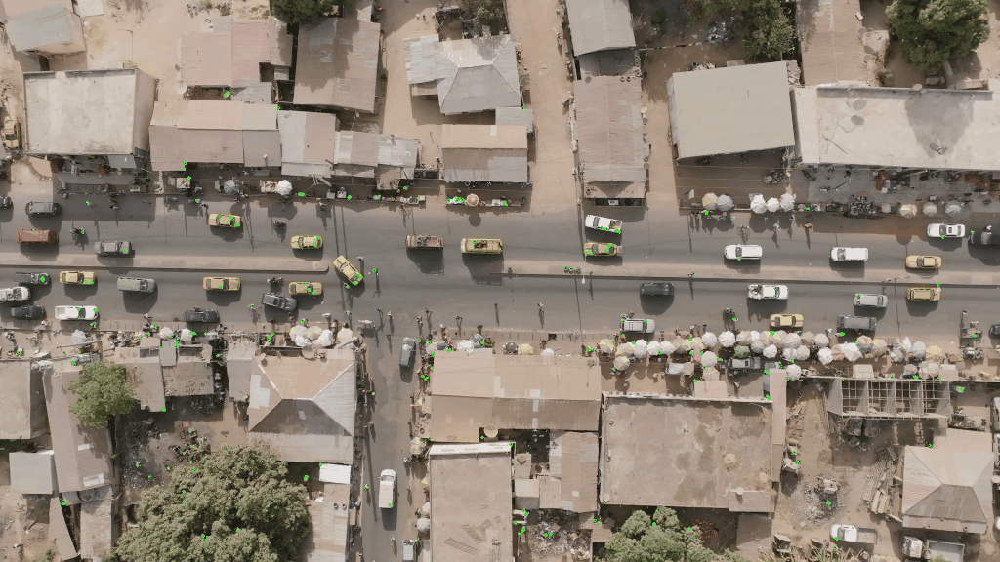

# Week 3 Assignment: Classical Motion Tracking

## Core Objective
This repository contains a foundational computer vision pipeline focusing on geometric feature extraction and tracking without relying on deep learning inference frameworks.

## Technical Implementation
* **Feature Detection & Description**: Utilizes the **ORB (Oriented FAST and Rotated BRIEF)** algorithm, optimized for efficient, real-time edge applications.
* **Vector Filtration**: Leverages a **Brute-Force Hamming Distance Matcher** paired with **Lowe's Ratio Test** to eliminate background noise and isolate valid vehicle trajectories.
* **Image Preprocessing**: Integrated local contrast enhancement via **CLAHE** to resolve keypoints on low-contrast vehicle surfaces.

## Classical Feature Tracker Proof
Below is the verified demonstration of the sparse tracking system in action, following the moving vehicles across the scene frames:

